## θ-dependence: QCD topology and Axion Physics

:::: {.columns}
::: {.column width="55%"}

::: {style="font-size:0.84em; margin-top:0.4em"}
Gauge fields carry an **integer** topological charge

$$Q=\frac{1}{32\pi^2}\!\int\! d^4x\,\varepsilon_{\mu\nu\rho\sigma}\,\mathrm{Tr}\,G_{\mu\nu}G_{\rho\sigma}\;\in\mathbb{Z}$$

and all of $\theta$-physics sits in the free energy

$$F(\theta,T)-F(0,T)=\tfrac12\chi(T)\,\theta^2\big[1+b_2(T)\,\theta^2+\dots\big]$$

$$\chi=\frac{\langle Q^2\rangle}{V_4},\qquad b_2=-\frac{\langle Q^4\rangle-3\langle Q^2\rangle^2}{12\,\langle Q^2\rangle}$$
:::

::: {.note style="margin-top:0.2em"}
Non-perturbative: the lattice is the only first-principles tool.
:::

:::
::: {.column width="45%"}

::: {.fragment}
::: {.lead style="margin-top:0.3em; margin-bottom:0.2em"}
**The QCD axion** needs them [**at high $T$**]{.defect}: [[1]]{color=gray}
:::
:::

::: {.fragment .card style="font-size:0.86em"}
[Mass]{.hd}
$m_a^2 f_a^2=\chi(T)$
:::

::: {.fragment .card style="font-size:0.86em"}
[Relic abundance: misalignment]{.hd}
$\chi(T)$ and $b_2(T)$ over a **range** of temperatures
:::

::: {.fragment .card .accent style="font-size:0.86em"}
[Thermal production: the source term]{.hd}
$\Gamma_{\rm top}(\omega,\vec p)=\displaystyle\int\! dt\,d^3x\,e^{i x_\mu p^\mu}\langle q(x)\,q(0)\rangle_T$
:::

:::
::::

::: {.fragment .takeaway style="margin-top:0.6em"}
All of them are needed **well above** $T_c$ $\;\Longrightarrow\;$ **fine** lattice spacings
:::

## The Problem: topological freezing

:::: {.columns}
::: {.column width="44%"}

::: {style="font-size:0.9em; margin-top:0.6em"}
At fixed $N_\tau$, $\;T=\dfrac{1}{N_\tau\, a}$: <br> high $T$ $\Longleftrightarrow$ $a\to 0$
:::

::: {.fragment fragment-index=0 style="margin-top:0.8em"}
Standard critical slowing down

$$\tau_{\rm int}(\mathcal O)\sim a^{-z}$$
:::

::: {.fragment fragment-index=1}
Topological freezing [[2]]{color=gray}

$$\tau_{\rm int}(Q)\sim e^{\,c/a}$$
:::

:::
::: {.column width="56%"}



:::
::::

::: {.fragment fragment-index=2 .lead style="margin-top:0.4em; text-align:center; font-size:0.91em"}
On top of that a **physical** suppression: $\chi(T)$ falls steeply, the chain sits at
$Q=0$, and the rare configurations that carry the signal are never sampled.
:::

::: {.fragment fragment-index=3 .takeaway}
Two fronts: [**what we can measure**]{.p1c} and [**how we can sample it**]{.p2c}
:::

## Projects carried in the first two years



::: {.fragment fragment-index=4 .takeaway style="margin-top:0.2em; font-size:0.86em"}
So [**Part II**]{.p2c} builds the samplers (hopefully) that [**Part I**]{.p1c} needs at high $T$
:::

## {.divider .d1}

:::: {.columns}
::: {.column width="40%"}

:::
::: {.column width="60%"}
::: {.kicker .p1}
Part I · Topological observables
:::
::: {.ptitle}
Real-time topological rate at finite momentum
:::
::: {.question}
How fast does the hot plasma turn topology into axions of momentum $p$?
:::
::: {.chips}
[arXiv:2608.12066]{.chip} [quenched SU(3), $T\simeq1.24\,T_c$]{.chip} [Lattice 2026]{.chip}
:::
::: {.with}
with C. Bonanno, M. D'Elia, G. Gagliardi, A. Giorgieri, F. Sanfilippo, A. Valentino, G. Villadoro
:::
:::
::::

## Axion production needs the rate at finite p {.p1}

::: {style="font-size:0.9em"}
Thermal axions obey a **momentum-dependent** Boltzmann equation [[3]]{color=gray}

$$\frac{df_{\vec p}}{dt}=(1+f_{\vec p})\,\Gamma_a^{(+)}(p)-f_{\vec p}\,\Gamma_a^{(-)}(p),
\qquad \Gamma_a^{(-)}(p)=\frac{\Gamma_{\rm top}(\omega=E_p,\,p)}{2E_p f_a^2}$$
:::

::: {.fragment .lead style="margin-top:0.2em; text-align:center; font-size:0.9em"}
Higher momenta decouple **later**: </br> modes may equilibrate at different times
$\Rightarrow$ the integrated (sphaleron) rate $\Gamma_{\rm top}(0,0)$ [[4]]{color=gray} is not enough.
:::

::: {.fragment style="margin-top:0.9em"}
:::: {.columns}
::: {.column width="50%"}
::: {.card}
[What the lattice measures]{.hd}
$$G_E(\tau,p)=\int\! d^3x\,e^{i\vec p\cdot\vec x}\langle q(\vec x,\tau)\,q(\vec 0,0)\rangle$$
:::
:::
::: {.column width="50%"}
::: {.card .accent}
[What we need ]{.hd}
$$\Gamma_{\rm top}(\omega,p)=\frac{2}{1-e^{-\omega/T}}\,\rho(\omega,p)$$
:::
:::
::::
:::

::: {.fragment .takeaway}
$\displaystyle G_E(\tau,p)=-\int_0^\infty\!\frac{d\omega}{\pi}\,\rho(\omega,p)\,
\frac{\cosh\!\big[\omega(\tfrac{1}{2T}-\tau)\big]}{\sinh\!\big(\tfrac{\omega}{2T}\big)}$
$\quad\Longrightarrow\quad$ an **inverse problem**
:::

## HLT algorithm {.p1}

::: {style="font-size:0.86em; text-align:center"}
**HLT** [[5]]{color=gray}: never reconstruct $\rho$ pointwise, target a **smeared** density
:::

::: {style="font-size:0.84em"}
$$\frac{\bar\rho(\omega^*\!,p)}{\omega^*}=-\pi\sum_\tau g_\tau(\omega^*)\,G_E(\tau,p)=\int\! d\omega\,\Delta_\sigma(\omega,\omega^*)\,\frac{\rho(\omega,p)}{\omega}$$
:::

:::: {.columns}
::: {.column width="52%"}

::: {style="font-size:0.82em"}
$g_\tau$ minimise

$$F_\lambda[g]=(1-\lambda)\,\underbrace{A[g]}_{\text{kernel bias}}+\lambda\,\underbrace{B[g]}_{\text{stat. variance}}$$
:::

::: {.note}
Scan $\lambda$ for the stability plateau; $\sigma/T\in[1.25,2.5]$, quoted at 1.75.
:::

:::
::: {.column width="48%"}

::: {.fragment style="font-size:0.82em"}
**Three limits**, in order

1. continuum $a\to0$ at fixed $R_s$
2. smoothing radius $R_s\to0$ (cooling)
3. smearing width $\sigma\to0$
:::

::: {.fragment .note}
$N_\tau=12,14,16$ at $LT=4$ $\Rightarrow$ $p/T$ up to $3\pi$
:::

:::
::::

::: {.fragment style="margin-top:0.5em"}
::: {style="text-align:center; font-size:0.74em; font-weight:500; color:#9c162a"}
Method 1 · extrapolate, then invert
:::
::: {.flow}
[$G_E(\tau,p;a,R_s)$]{.box} [→]{.arrow} [$a\to0$, then $R_s\to0$]{.box} [→]{.arrow} [HLT]{.box .net} [→]{.arrow} [$\Gamma_{\rm top}(\omega,p)$]{.box}
:::
::: {style="text-align:center; font-size:0.74em; font-weight:500; color:#3b7ea1; margin-top:0.3em"}
Method 2 · invert, then extrapolate the rate
:::
::: {.flow}
[$G_E(\tau,p;a,R_s)$]{.box} [→]{.arrow} [HLT]{.box .net} [→]{.arrow} [$a\to0$, then $R_s\to0$]{.box} [→]{.arrow} [$\Gamma_{\rm top}(\omega,p)$]{.box}
:::
:::

## The on-shell rate grows linearly with p {.money .p1}

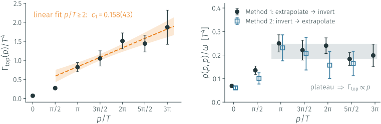{.tall}

:::: {.columns}
::: {.column width="50%"}
::: {.fragment .lead style="text-align:center; font-size:0.72em"}
**Linear growth** for $p/T\geq2$, as semiclassics predicts [[6]]{color=gray} <br>
$\Gamma_{\rm top}\propto p\,(\alpha_sT)^3\big[A\log\frac{pT}{m_D^2}+B\big]$, already at $1.24\,T_c$
:::
:::
::: {.column width="50%"}
::: {.fragment .lead style="text-align:center; font-size:0.72em"}
The two orderings of the limits **agree** at every momentum. <br>
$G_E$ is *suppressed* with $p$, but on shell the growth with $\omega$ wins.
:::
:::
::::

## {.divider .d1}

:::: {.columns}
::: {.column width="40%"}

:::
::: {.column width="60%"}
::: {.kicker .p1}
Part I · Topological observables
:::
::: {.ptitle}
$b_2$ across the chiral crossover
:::
::: {.question}
Where does QCD start behaving like a dilute gas of instantons?
:::
::: {.chips}
[$N_f=2+1$ QCD]{.chip} [$T=130$–$200$ MeV]{.chip} [Nicolò Francesconi's MSc thesis]{.chip}
:::
:::
::::

## Beyond χ: b₂ shapes the axion potential {.p1}

:::: {.columns}
::: {.column width="52%"}

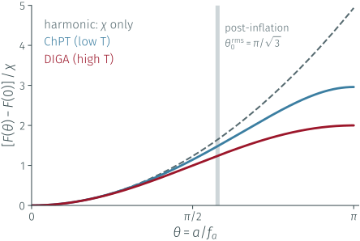{.tall}

:::
::: {.column width="48%"}

::: {style="font-size:0.8em; margin-top:0.3em"}
The axion potential **is** the QCD free energy:

$$V(a)=\tfrac12\,m_a^2\,a^2\Big[1+b_2\,\frac{a^2}{f_a^2}+\dots\Big],\qquad m_a^2f_a^2=\chi$$
:::

::: {.fragment .card style="font-size:0.72em"}
[$b_2$ is the axion self-coupling]{.hd}
$\lambda_a=12\,b_2\,m_a^2/f_a^2$: at $T=0$, $b_2=-0.029$ gives $\lambda_a\simeq-0.35\,m_a^2/f_a^2$,
an **attractive** self-interaction [[1]]{color=gray}.
:::

::: {.fragment .card .accent style="font-size:0.72em"}
[Misalignment does not start at small angles]{.hd}
Post-inflation, $\theta_0^{\rm rms}=\pi/\sqrt3$; pre-inflation, the smallest $f_a$ needs $\theta_0\to\pi$.
There the harmonic approximation fails, and the anharmonic terms are set by $b_2(T)$ around $T_{\rm osc}$.
:::

:::
::::

::: {.fragment .takeaway style="font-size:0.84em"}
$\chi(T)$ fixes the **curvature** of the potential; $b_2(T)$ fixes its **shape**
:::

## From chiral perturbation theory to DIGA {.p1}

:::: {.columns style="margin-top:0.8em"}
::: {.column width="50%"}
::: {.card style="font-size:0.84em"}
[Low temperatures · chiral perturbation theory]{.hd}
$$b_2(0)\simeq-0.029$$
Predicted by the light-quark mass ratios.
:::
:::
::: {.column width="50%"}
::: {.card .alert style="font-size:0.84em"}
[High temperatures · dilute instanton gas approximation]{.hd}
$$b_2^{\mathrm{DIGA}}=-\frac{1}{12},\qquad b_4^{\mathrm{DIGA}}=\frac{1}{360}$$
Characteristic values of the DIGA regime.
:::
:::
::::

::: {.fragment fragment-index=0 .card .accent style="font-size:0.84em; margin-top:0.6em"}
[Pure Yang–Mills vs. QCD]{.hd}
```{=html}
<ul style="margin:0.2em 0 0 1.1em">
  <li>Pure SU(3) Yang–Mills: first-order deconfinement transition <span style="color:gray">[20]</span>.</li>
  <li class="fragment" data-fragment-index="1">Physical QCD: crossover; the approach to the DIGA regime is not fixed by the transition temperature.</li>
</ul>
```
:::

::: {.fragment fragment-index=2 .takeaway style="font-size:0.84em; margin-top:0.8em"}
The temperature dependence of $b_2$ provides a **diagnostic of the approach to the DIGA regime**.
Establishing the onset of DIGA is important for assessing the reliability of high-temperature
extrapolations of $\chi(T)$, a key input for QCD axion cosmology.
:::

## b₂ across the crossover in Nf = 2+1 QCD {.p1}



:::: {.columns}
::: {.column width="50%"}
::: {.fragment fragment-index=0 .lead style="text-align:center; font-size:0.74em"}
$T=130$ MeV: [$-0.031(12)$]{.easy}, on the **ChPT** value
:::
:::
::: {.column width="50%"}
::: {.fragment fragment-index=1 .lead style="text-align:center; font-size:0.74em"}
$T=200$ MeV: [$-0.079(4)$]{.target}, on the **DIGA** value
:::
:::
::::

::: {.fragment fragment-index=2 .takeaway style="font-size:0.84em"}
The whole ChPT → DIGA transition, resolved for the first time in $N_f=2+1$ QCD. <br>
How QCD gets from one end to the other: **Nicolò's MSc defence, next week**.
:::

## {.divider .d1}

:::: {.columns}
::: {.column width="40%"}

:::
::: {.column width="60%"}
::: {.kicker .p1}
Part I · Topological observables
:::
::: {.ptitle}
Lines of constant physics at high temperature
:::
::: {.question}
Higher $T$ means finer $a$: </br> charm is dynamical ($N_f=2+1+1$), and the $T=0$ route costs $\propto a^{-4}$.
:::
::: {.chips}
[gradient-flow step scaling]{.chip} [bare parameters]{.chip } [fermion flow]{.chip .wip}
:::
:::
::::

## The gradient flow {.p1}

:::: {.columns}
::: {.column width="54%"}

::: {style="font-size:0.8em; margin-top:0.9em"}
Evolve the links $V_\mu(x,t)$, from $V_\mu(x,0)=U_\mu(x)$, in a fictitious **flow time** $t$ [[21]]{color=gray}:

$$\partial_t V_\mu(x,t)=-g_0^2\,\big\{\partial_{x,\mu}S_W[V]\big\}\,V_\mu(x,t)$$

UV fluctuations are averaged over a radius $\sqrt{8t}$; flowed gluonic observables are **finite**, with no further renormalisation:

$$g^2_{\rm flow}(\mu)=\frac{16\pi^2}{3}\,t^2\langle E(t)\rangle\Big|_{\mu=1/\sqrt{8t}}$$
:::

::: {.fragment .card style="font-size:0.7em; margin-top:0.4em"}
[The step-scaling procedure]{.hd}

1. reference ensemble $(\beta_1,a_1)$ on $N_s^3\times N_\tau$
2. target $(sN_s)^3\times sN_\tau$ at trial $\beta_2$: same box and $T$ **iff** $a_2=a_1/s$
3. flow both, read $\hat t_1,\hat t_2$ where $g^2_{\rm flow}$ is equal
4. $s(\beta_2)=\sqrt{\hat t_2/\hat t_1}$; scan $\beta_2$ until $s$ hits its target
:::

:::
::: {.column width="46%"}

<div style="text-align:center; margin-top:-1em">
</div>
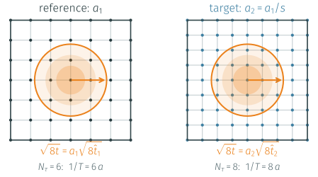

::: {.note style="text-align:center; margin-top:-1.6em"}
One physical flow radius, more sites on the finer lattice: $\hat t_2/\hat t_1=s^2$
:::

::: {.fragment .card .accent style="font-size:0.7em"}
[Why it suits high $T$:]{.hd}
<div style="margin-top:-0.2em">
1. Only a local gluonic observable, measured **on the finite-$T$ ensembles**:
2. No hadron spectroscopy
3. No $T=0$ runs at $a^{-4}$ cost.
</div>
:::

:::
::::

## Step scaling: the gauge coupling from the flow {.p1}

::: {style="font-size:0.84em; text-align:center"}
Same $g^2_{\rm flow}$ $\Rightarrow$ same physical flow time on both lattices [[7]]{color=gray}:
$\quad t=a_1^2\hat t_1=a_2^2\hat t_2\;\Longrightarrow\; s\equiv\dfrac{a_1}{a_2}=\sqrt{\hat t_2/\hat t_1}$
:::

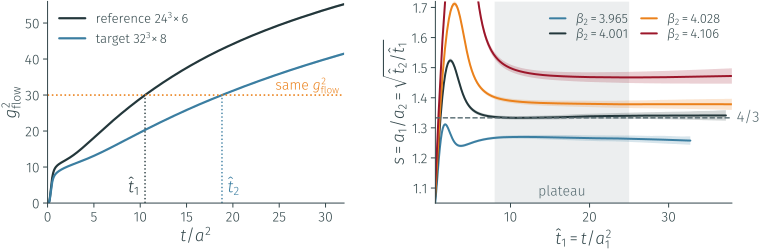{.short}

:::: {.columns}
::: {.column width="52%"}
::: {.fragment .lead style="font-size:0.72em; margin-top:0.3em"}
Purely gluonic and local: it works **at finite $T$**. <br>
A flat plateau in $1\ll\hat t\ll N_\tau^2$, moving monotonically with $\beta_2$:
scan and interpolate to the target $s$.
:::
:::
::: {.column width="48%"}
::: {.fragment style="margin-top:-0.7em;"}
<table class="simstab">
<tr><th>theory</th><th>step</th><th>$T$ [MeV]</th><th>$\beta_2^\star$</th></tr>
<tr><td>$2+1$ (check)</td><td>$24^3\!\times\!6\to32^3\!\times\!8$</td><td>498</td><td>4.121</td></tr>
<tr><td>$2+1+1$</td><td>$24^3\!\times\!6\to32^3\!\times\!8$</td><td>498</td><td>4.004</td></tr>
<tr><td>$2+1+1$</td><td>$24^3\!\times\!8\to36^3\!\times\!12$</td><td>374</td><td>4.040</td></tr>
</table>
::: {.note style="text-align:center; margin-top:-0.2em"}
Agrees with the BMW scale setting [[8]]{color=gray} at the **per-mille** level
:::
:::
:::
::::

## Fixing the quark masses: screening masses {.p1}

:::: {.columns}
::: {.column width="52%"}

::: {.card .alert style="font-size:0.72em"}
[Why not the time direction?]{.hd}
At finite $T$ it is only $1/T=N_\tau a$ long: $N_\tau/2=3$–$4$ independent points,
far too few to isolate a ground state.
:::

::: {.fragment .card style="font-size:0.72em"}
[Use a long spatial direction]{.hd}
$L=N_sa$ with $LT=4$:
$$\;C(z)=\sum_{x,y,\tau}\langle O(x,y,z,\tau)\,O^\dagger(0)\rangle\sim e^{-m_{\rm scr}z}$$

$m_{\rm scr}$ is an eigenvalue of the transfer matrix along $z$: the inverse
correlation length of the plasma in that channel.<br> Not a pole mass: the bath breaks Lorentz symmetry.
:::

:::
::: {.column width="48%"}

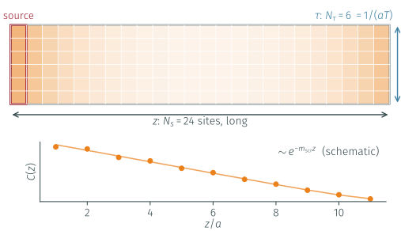

:::
::::

::: {.fragment .card .accent style="font-size:0.72em"}
[The matching]{.hd}

- Same $T$ on both lattices, so equal $m_{\rm scr}/T$ means equal physics.
- Scan $a\hat m_s$ on the
target (ratios $m_s/m_l$, $m_c/m_s$ fixed) and interpolate to the reference value.
- Staggered fits: $C(z)=A\cosh[m(z-\tfrac L2)]+(-1)^zA'\cosh[m'(z-\tfrac L2)]$.
:::

## Quark masses: screening masses not reliable at high T {.p1}

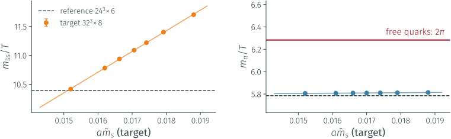{.short}

:::: {.columns}
::: {.column width="50%"}
::: {.fragment .card style="font-size:0.74em"}
[At high $T$ every quark carries at least $\pi T$]{.hd}
$m_{\rm scr}\to 2\pi T+\mathcal O(m^2/T)$ [[9]]{color=gray}: the dependence on the
bare mass is washed out.
:::
:::
::: {.column width="50%"}
::: {.fragment .card .alert style="font-size:0.74em"}
[Already at $T\simeq 500$ MeV]{.hd}
$\bar ss$ still tunes; the pion sits **7–8 % below** $2\pi$. <br>
Towards 1 GeV even $s$ and $c$ saturate.
:::
:::
::::

::: {.fragment .takeaway style="font-size:0.84em"}
We need a **short-distance** fermionic observable, decoupled from the thermal bath
:::

## Flowed quark bilinears {.p1 .wip}

:::: {.columns}
::: {.column width="53%"}

::: {style="font-size:0.8em"}
Flow the **quark fields** too (Lüscher [[10]]{color=gray}) to $\sqrt{8t}=c\,L$ and take

$$z_f=\mathcal N_m^{-1}\,\frac{L}{t}\,
\frac{\langle\bar\chi_f\chi_f\rangle_t}{\langle\bar\chi_f\gamma_\mu\overleftrightarrow{D}_{\!\mu}\chi_f\rangle_t}
\;=\;L\,m_f^{\rm R}(\mu\sim 1/L)$$
:::

::: {.fragment style="font-size:0.76em"}
- field renormalisation **cancels** in the ratio
- numerator chirality-odd (needs $m$), denominator even
- staggered: a **two-link** flow keeps the remnant $U(1)_\varepsilon$
  $\Rightarrow$ no additive renormalisation, **one** $Z$ for all flavours
:::

::: {.fragment .note style="margin-top:0.5em"}
New `fermion_flow_meas` implemented in OpenStaPLE (GPU, OpenACC).
:::

:::
::: {.column width="47%"}

::: {.fragment}
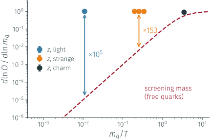

::: {.note style="text-align:center"}
Better Sensitivity than Screening masses:
$1\%$ of $m$ moves $z$ by $1\%$
:::
:::

:::
::::

## z is a genuine renormalised mass {.p1 .wip}

:::: {.columns}
::: {.column width="50%"}

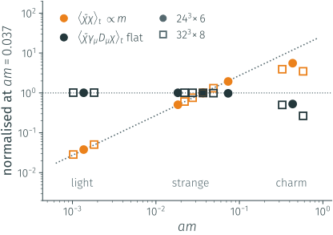{.tall}

::: {.fragment .lead style="text-align:center; font-size:0.72em"}
Numerator $\propto m$ for a large range of masses, denominator flat. <br>
$z(m\to0)=0.0001(1)$ on $32^3\!\times\!8$: **no additive renormalisation**
:::

:::
::: {.column width="50%"}

::: {.fragment}
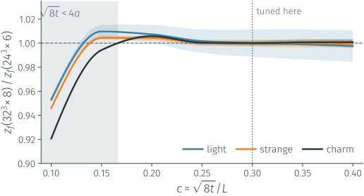{.tall}

::: {.lead style="text-align:center; font-size:0.72em"}
Masses tuned at $c=0.3$ only: the whole $z(c)$ agrees between the two spacings
within $0.5\%$ once $\sqrt{8t}\gtrsim4a$. **The flow removes the cutoff.**
:::
:::

:::
::::

## First tuning: β = 3.873 → 4.010 {.p1 .wip}

:::: {.columns}
::: {.column width="52%"}

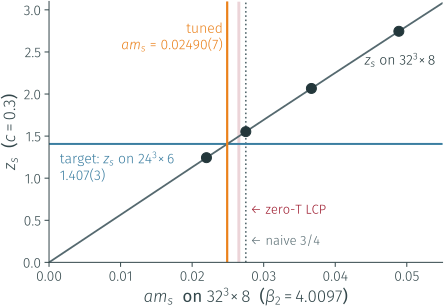{style="max-height:60vh"}

:::
::: {.column width="48%"}

<div style="text-align: center; margin-top:0.5em">
<table class="simstab" style="font-size:0.66em; margin-top:0.4em;">
<tr><th></th><th>$am^{\rm tuned}(\beta_2)$</th><th>$am(\beta_2)/am(\beta_1)$</th></tr>
<tr><td>light</td><td>0.000934(11)</td><td>0.685(8)</td></tr>
<tr><td>strange</td><td>0.02490(7)</td><td>0.679(2)</td></tr>
<tr><td>charm</td><td>0.2973(6)</td><td>0.684(1)</td></tr>
</table>
</div>

::: {.fragment style="font-size:0.76em; margin-top:0.5em"}
- **0.3 %** on $m_s$ in **~20 A100-hours**, on existing configurations
- the **same** factor for $l,s,c$, flat in $c$
- flavour ratios reproduced: <br> $m_c/m_s=11.94(7)$ (LCP 11.85), $m_s/m_l=26.7(2)$ (26.91)
:::

::: {.fragment .card .accent style="font-size:0.74em; margin-top:0.6em"}
[Open "Problem":]{.hd}
The overall scale sits **6–7 % below** the zero-$T$ LCP, far beyond the errors:

- cutoff effects constant in $c$? running? 
- A third lattice spacing will settle this.
:::

:::
::::

## {.divider .d2}

:::: {.columns}
::: {.column width="40%"}

:::
::: {.column width="60%"}
::: {.kicker .p2}
Part II · Algorithmic challenges
:::
::: {.ptitle}
Sampling topology with normalizing flows
:::
::: {.question}
Can a learned map jump over the barrier, instead of climbing it?
:::
::: {.chips}
[2D $U(1)$ gauge theory]{.chip} [exactly solvable testbed]{.chip} [vs HMC]{.chip}
:::
:::
::::

## A flow is a learned change of variables {.p2}
<div style=" margin-top:-1em">

</div>
:::: {.columns}
::: {.column width="60%"}

```{=html}
<div class="toyflow"><canvas width="1200" height="1000"></canvas></div>
<script src="figures/toyflow/toyflow_data.js"></script>
<script src="figures/toyflow/toyflow.js"></script>
```

:::
::: {.column width="40%"}

::: {style="font-size:0.74em; margin-top:0.1em"}
Toy Model $p_\beta\propto e^{-S_\beta}$:

- five **sectors** $Q$ behind barriers $\propto\beta$.
- Draw $z\sim\mathcal N(0,\mathbb 1)$
- Push it through $x=f_\theta(z)$:

$$q(x)=q_0(z)\,\big|\det\partial f_\theta/\partial z\big|^{-1}$$
:::

::: {.fragment .tf-step .card data-step="0" style="font-size:0.68em"}
[Learned from the action alone]{.hd}
8 spline coupling layers, each moving **one** coordinate given the other (cheap Jacobian).
Trained in **5 s** by minimising $\mathrm{KL}(q\|p)$ with $\beta$ annealed from 0 to 7.
:::

::: {.fragment .tf-step .card .alert data-step="1" style="font-size:0.68em"}
[Never trusted]{.hd}
$w=p/q$ is known for every sample: ESS $=84\%$. The flow **under-fills** $Q=\pm2$ by up to
$2\times$ (hollow bars); reweighting or Metropolis restores the exact $P(Q)$.
:::

::: {.fragment .tf-step .card .accent data-step="2" style="font-size:0.68em"}
[Independent proposals beat freezing]{.hd}
Flow beats Local Metropolis by **4 orders of magnitude** in $\tau_{\rm int}(Q)$ at $\beta=7$.
:::

:::
::::

## Flow vs HMC{.p2}

::: {.note style="text-align:center; margin-top:-0.4em"}
Testbed: 2D $U(1)$, $\pi_1(U(1))=\mathbb Z$, freezes like QCD and is **exactly solvable**;<br>
the flow reproduces the free energy to 5 digits ($-F=568.424(48)$ vs $568.422$ at $\beta=7$).
:::

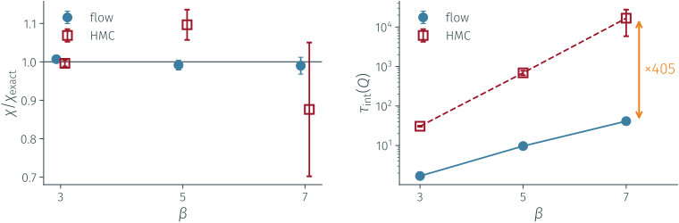

:::: {.columns}
::: {.column width="50%"}
::: {.fragment .lead style="text-align:center; font-size:0.72em"}
$L=24$: $\chi$ within $1\%$ at every $\beta$, with an error **8× smaller** <br>
from **7× fewer** samples (131k flow proposals vs 950k HMC trajectories)
:::
:::
::: {.column width="50%"}
::: {.fragment .lead style="text-align:center; font-size:0.72em"}
$\tau_{\rm int}(Q)$: HMC grows $\times500$ over the range, the flow $\times24$ <br>
→ a factor [**~400**]{.defect} at $\beta=7$
:::
:::
::::

## A physics-informed spectral conditioner {.p2}

:::: {.columns}
::: {.column width="50%"}

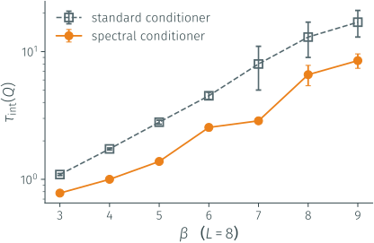{.tall}

:::
::: {.column width="50%"}

::: {style="font-size:0.8em; margin-top:0.8em"}
At large $\beta$ the information moves to the **infrared**: let the conditioner
see a low-pass copy of the field

$$F_{\rm LP}(k)=\frac{1}{1+2^{\,k-|k_c|}},\qquad k_c\ \text{trainable}$$
:::

::: {.fragment .card style="font-size:0.76em"}
[The measure is untouched]{.hd}
The filter acts on a **copy** fed only to the conditioner: $\log\det J$ is unchanged.
:::

::: {.fragment .takeaway style="font-size:0.84em"}
$\tau_{\rm int}(Q)$ **halved**, uniformly in $\beta$
:::

:::
::::

## The Problem: {.p2}

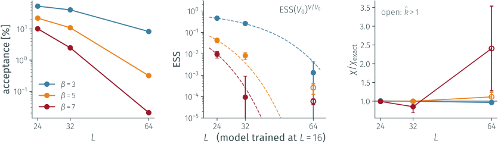

:::: {.columns}
::: {.column width="50%"}
::: {.fragment .lead style="text-align:center; font-size:0.72em"}
One model, evaluated at $L=24\to64$: acceptance $10\%\to0.02\%$ at $\beta=7$,
$\chi$ off by $\times2.4$. <br> Freezing reappears **inside** the flow.
:::
:::
::: {.column width="50%"}
::: {.fragment .lead style="text-align:center; font-size:0.72em"}
$\mathrm{ESS}(V)=\mathrm{ESS}(V_0)^{V/V_0}$ [[13]]{color=gray}: $V/V_0$ independent
regions, a small imperfection in each, **compounded**.
:::
:::
::::

::: {.fragment .takeaway style="font-size:0.84em"}
No single map can be trained across the whole distance on a physical lattice
$\;\Rightarrow\;$ take **many small steps**
:::

## {.divider .d2}

:::: {.columns}
::: {.column width="40%"}

:::
::: {.column width="60%"}
::: {.kicker .p2}
Part II · Algorithmic challenges
:::
::: {.ptitle}
Optimal annealing paths through distribution space
:::
::: {.question}
If we have to take many small steps, where should they go?
:::
::: {.chips}
[Fisher information geometry]{.chip} [learned coupling fields]{.chip} [$CP^{N-1}$]{.chip} [arxiv:2610.XXXX]{.chip}
:::
::: {.with}
with E. Cellini, G. Kanwar, S. Widyanto
:::
:::
::::

## Many small steps: tempering on boundary conditions {.p2}

::: {style="font-size:0.84em; text-align:center; margin-top:-1.4em"}
$S_\lambda=(1-\lambda)\,S_{\rm open}+\lambda\,S_{\rm periodic}$, traversed **in sequence** (stochastic NFs [[14]]{color=gray}) or **in parallel** (PT)
:::

:::: {.columns}
::: {.column width="50%"}

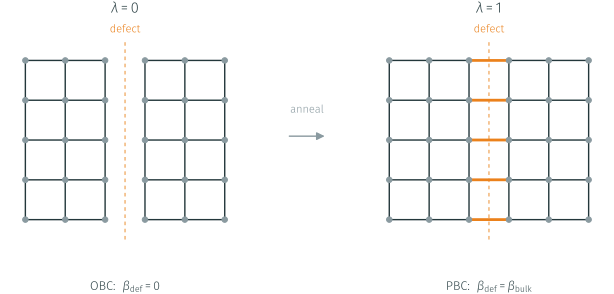{.short}

::: {.note style="text-align:center"}
A **defect** of links with coupling $\lambda\,\beta$:<br> open at $\lambda=0$ ($Q$ free), periodic at $\lambda=1$ [[15]]{color=gray}
:::

:::
::: {.column width="50%"}

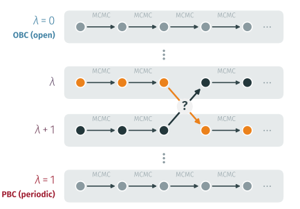{.short}

:::
::::

::: {.fragment style="font-size:0.78em; text-align:center; margin-top:-1.2em"}
Swap neighbours with $A=\min\!\Big(1,\frac{p_{\lambda_r}(x_{r+1})\,p_{\lambda_{r+1}}(x_r)}{p_{\lambda_r}(x_r)\,p_{\lambda_{r+1}}(x_{r+1})}\Big)$;<br> measure on the periodic replica only: **exact**,
and already in production in full 2+1 QCD [[16]]{color=gray}
:::

::: {.fragment .takeaway style="font-size:0.82em"}
The free parameter nobody optimises: the **schedule** $0=\lambda_0<\lambda_1<\dots<\lambda_N=1$
:::

## Information geometry fixes the schedule {.p2}

:::: {.columns}
::: {.column width="54%"}

::: {style="font-size:0.82em"}
The **Fisher metric** on the family, measurable as a variance:

$$g(\lambda)=\mathbb E_{p_\lambda}\!\big[(\partial_\lambda\log p_\lambda)^2\big]=\mathrm{Var}_{p_\lambda}\!\big[\partial_\lambda S_\lambda\big]$$

$D_{\rm KL}(p_\lambda\|p_{\lambda+d\lambda})\simeq\tfrac12 g\,d\lambda^2$: large $g$ = hard to bridge.
:::

::: {.fragment style="font-size:0.82em; margin-top:0.4em"}
Thermodynamic length [[17]]{color=gray} and dissipation

$$\Lambda=\int_0^1\!\sqrt{g}\,d\lambda=\sum_k\Delta\ell_k,\qquad W_{\rm diss}\propto\sum_k\Delta\ell_k^2$$
:::

::: {.fragment .eqbox style="display:block; width:max-content; margin:0.4em auto; font-size:0.86em"}
geodesic: $\;\Delta\ell_k=\Lambda/N\;\Longleftrightarrow\;\dfrac{d\lambda}{dt}\propto\dfrac{1}{\sqrt{g(\lambda)}}$
:::

:::
::: {.column width="46%"}

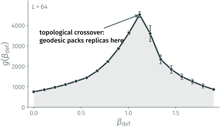

::: {.fragment .note style="text-align:center"}
$g$ peaks at the **topological crossover**: <br> that is where the replicas must go.
:::

:::
::::

## The bottleneck in the ladder disappears {.p2}

:::: {.columns}
::: {.column width="58%"}

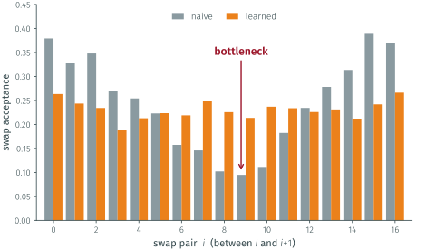{style="max-height:46vh"}

:::
::: {.column width="42%"}

::: {.fragment fragment-index=2}
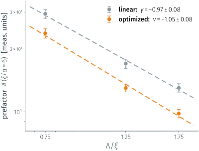{style="max-height:44vh"}
:::

:::
::::

:::: {.columns}
::: {.column width="58%"}
::: {.fragment fragment-index=1 .lead style="font-size:0.74em; margin-top:0.3em"}
- uniform ladder: swap acceptance collapses to **9.5 %** at the crossover
- optimised schedule: every pair near **22 %**, replicas round-trip;
- $CP^{20}$, $L=150$: the periodic replica visits $Q=-8\dots+8$
:::
:::
::: {.column width="42%"}
::: {.fragment fragment-index=2 .lead style="font-size:0.74em; margin-top:0.3em; text-align:center"}
$\tau_{\rm int}(Q^2)\sim A\,(\xi/a)^z$: a power law, <br> and [**−20 %**]{.defect} on $A$, at no extra cost
:::
:::
::::

## {.divider .d2}

:::: {.columns}
::: {.column width="40%"}

:::
::: {.column width="60%"}
::: {.kicker .p2}
Part II · Algorithmic challenges
:::
::: {.ptitle}
Out-of-equilibrium replica exchange
:::
::: {.question}
We chose where the replicas sit.<br> Can the swap itself be made better?
:::
::: {.chips}
[O-REX]{.chip} [exact for any protocol]{.chip} [$CP^{20}$]{.chip} [no neural network (yet)]{.chip} [arxiv:2610.XXXX]{.chip}
:::
:::
::::

## O-REX: drive the couplings past each other {.p2}

<div style="margin-top:+3em">

</div>

:::: {.columns}
::: {.column width="48%"}



:::
::: {.column width="52%"}

::: {.fragment fragment-index=1 style="font-size:0.78em"}
$n_{\rm step}$ jumps with local relaxation in between [[18]]{color=gray}. The action is **linear** in
the defect coupling, $S=S_{\rm bulk}+C\,E_{\rm def}$, so

$$W=\sum_k\Big[\Delta C_r^{(k)}E_{\rm def}(x_r^{(k)})+\Delta C_s^{(k)}E_{\rm def}(x_s^{(k)})\Big]$$

accept with $\min(1,e^{-W})$ and $n_{\rm step}=0$ is the standard swap.
:::

::: {.fragment fragment-index=2 .card style="font-size:0.74em"}
[Exact for any $n_{\rm step}$]{.hd}
Same ensembles at both ends: Jarzynski [[19]]{color=gray} gives $\langle e^{-W}\rangle=1$,
and $\langle W\rangle$ is the dissipation, i.e. a KL divergence: the flows' loss.
:::

:::
::::

::: {.fragment fragment-index=3 .card .accent style="font-size:0.74em"}
[Made it cheap]{.hd}
In theory we should relax the full lattice between jumps; in practice we can
relax only a patch of half-size $L_R$ around the defect; the figure of merit is
$\tau_{\rm int}(Q^2)\times\text{cost}$.
:::

## O-REX in CP²⁰: a 1.77× gain at equal cost {.money .p2}

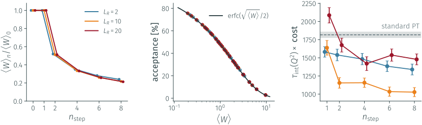

:::: {.columns}
::: {.column width="33%"}
::: {.fragment .lead style="text-align:center; font-size:0.7em"}
Dissipation cut **5×** at $n_{\rm step}=8$, independent of $N_R$: $\langle W\rangle_8/\langle W\rangle_0=0.217$
:::
:::
::: {.column width="33%"}
::: {.fragment .lead style="text-align:center; font-size:0.7em"}
All 126 runs on the **parameter-free** law ${\rm erfc}(\sqrt{\langle W\rangle}/2)$, within 0.6 points
:::
:::
::: {.column width="34%"}
::: {.fragment .lead style="text-align:center; font-size:0.7em"}
$1817\to1028$: gain [**1.77(12)**]{.defect} at $L_R=10$; <br> the best patch is $\sim2\xi$
:::
:::
::::

## To Sum up {.p2}

::: {.results}
::: {.colhd .p1c}
Topological observables
:::
::: {.colhd .p2c}
Algorithmic challenges
:::

::: {.rc .k1}
[Topological rate at finite $p$]{.t}
first lattice determination at $p\neq0$: $\Gamma_{\rm top}\propto p$ up to $p/T\simeq3\pi$, two orderings agree
:::
::: {.rc .k4}
[Normalizing flows]{.t}
$\tau_{\rm int}(Q)$ **~400×** below HMC at $\beta=7$; spectral conditioner another **2×**; ESS wall in $V$
:::

::: {.rc .k2}
[$b_2$ across the crossover]{.t}
first determination in $N_f=2+1$: from ChPT at 130 MeV to DIGA at 200 MeV (N. Francesconi's MSc)
:::
::: {.rc .k5}
[Optimal annealing paths]{.t}
Fisher geodesic **learned from samples**: bottleneck removed, **−20 %** on the prefactor
:::

::: {.rc .k3}
[Lines of constant physics]{.t}
step scaling: **per-mille** agreement with BMW; fermion flow: masses to **0.3 %** (WIP)
:::
::: {.rc .k6}
[Out-of-equilibrium exchange]{.t}
exact, controlled by the same thermodynamic length: **1.77(12)×** at equal cost
:::
:::

## Third year plan
<div style="margin-top:+3.5em;">
</div>
::: {.tracks}
::: {.tr .t1}
[1]{.n}
[$\Gamma_{\rm top}(p)$ in full QCD]{.t}

- $N_f=2+1$, physical masses: does $\Gamma\propto p$ survive?
- one temperature first then a scan towards **500 MeV**
:::
::: {.tr .t2}
[2]{.n}
[The LCP, closed]{.t}

- third lattice spacing: the **closure test** of the fermion flow
- mass step-scaling function $\sigma_z$
- Producing $2+1+1$ ensembles for the high-$T$ plan
:::
::: {.tr .t3}
[3]{.n}
[NEO-REX]{.t}

- trainable gauge-equivariant (stout-like) maps between the O-REX steps
- train by minimising $\langle W\rangle$; patch $\sim\xi$, **not** $V$: no ESS wall
- scaling to the continuum, then 4D
:::
:::

::: {.fragment style="margin-top:0.9em"}
::: {.flow style="font-size:0.74em"}
[enhanced sampler]{.box .net} [→]{.arrow} [ensembles on the $N_f=2+1+1$ LCP]{.box} [→]{.arrow} [$\chi,\ b_2,\ \Gamma_{\rm top}(p)$ at high $T$]{.box .ok}
:::
:::

# Thank you for your attention! {.center}

## References

::: {.refs}
[[1]]{.k} Grilli di Cortona, Hardy, Pardo Vega, Villadoro, JHEP 01 (2016) 034 <br>
[[2]]{.k} Del Debbio, Manca, Vicari, PLB 594 (2004) 315; Schaefer, Sommer, Virotta, NPB 845 (2011) 93 <br>
[[3]]{.k} Notari, Rompineve, Villadoro, PRL 131 (2023) 011004 [arXiv:2211.03799] <br>
[[4]]{.k} Bonanno, D'Angelo, D'Elia, Maio, Naviglio, PRD 108 (2023) 074515; PRL 132 (2024) 051903 <br>
[[5]]{.k} Hansen, Lupo, Tantalo, PRD 99 (2019) 094508 [arXiv:1903.06476] <br>
[[6]]{.k} Graf, Steffen, PRD 83 (2011) 075011; Salvio, Strumia, Xue, JCAP 01 (2014) 011 <br>
[[7]]{.k} Junnarkar, Moore, Chaumet, PRD 108 (2023) 074512 <br>
[[8]]{.k} Borsanyi et al., JHEP 09 (2012) 010; PRL 125 (2020) 052001; Bellwied et al., PRD 92 (2015) 114505 <br>
[[9]]{.k} Dalla Brida, Giusti, Harris, Laudicina, Pepe, JHEP 04 (2022) 034 [arXiv:2112.05427] <br>
[[10]]{.k} Lüscher, JHEP 04 (2013) 123 [arXiv:1302.5246] <br>
[[11]]{.k} Lüscher, Commun. Math. Phys. 293 (2010) 899 <br>
[[12]]{.k} Albergo, Kanwar, Shanahan, PRD 100 (2019) 034515; Kanwar et al., PRL 125 (2020) 121601 <br>
[[13]]{.k} Abbott et al., EPJA 59 (2023) 257 [arXiv:2211.07541] <br>
[[14]]{.k} Caselle, Cellini, Nada, Panero, JHEP 07 (2022) 015 [arXiv:2201.08862] <br>
[[15]]{.k} Hasenbusch, PRD 96 (2017) 054504; Berni, Bonanno, D'Elia, PRD 100 (2019) 114509 <br>
[[16]]{.k} Bonanno, Clemente, D'Elia, Maio, Parente, JHEP 08 (2024) 236; Bonanno et al., EPJC 84 (2024) 916 <br>
[[17]]{.k} Crooks, PRL 99 (2007) 100602; Sivak, Crooks, PRL 108 (2012) 190602 <br>
[[18]]{.k} Ballard, Jarzynski, PNAS 106 (2009) 12224; Bonanno, Nada, Vadacchino, JHEP 04 (2024) 126 <br>
[[19]]{.k} Jarzynski, PRL 78 (1997) 2690 <br>
[[20]]{.k} Bonati, D'Elia, Panagopoulos, Vicari, PRL 110 (2013) 252003 <br>
[[21]]{.k} Lüscher, JHEP 08 (2010) 071 [arXiv:1006.4518] <br>
:::

## Backup · code correctness {.p1 .wip}

:::: {.columns}
::: {.column width="50%"}
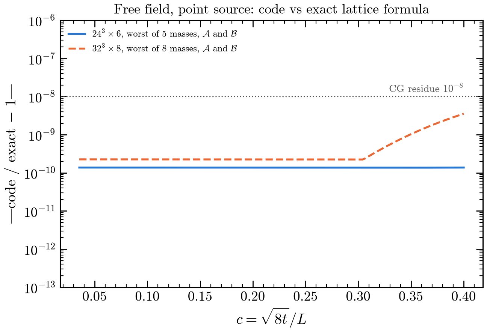
:::
::: {.column width="50%"}
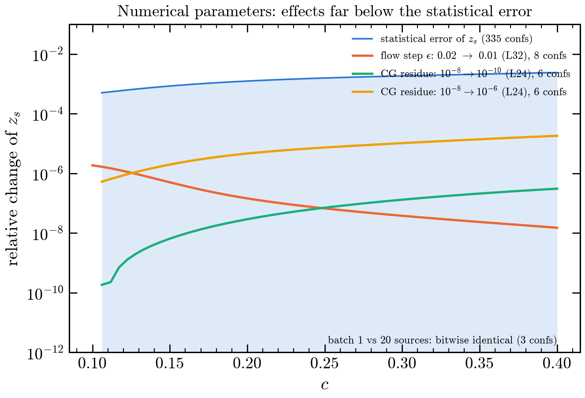
:::
::::

::: {.note style="text-align:center"}
Free field: exact finite-box formula to $10^{-10}$ ($24^3$) and $4\cdot10^{-9}$ ($32^3$).
Flow step $0.02\to0.01$: $\le 2\cdot10^{-6}$; CG residue $10^{-8}\to10^{-10}$: $\le3\cdot10^{-7}$; batching: bitwise identical.
:::

## Backup · the noisy light quark {.p1 .wip}

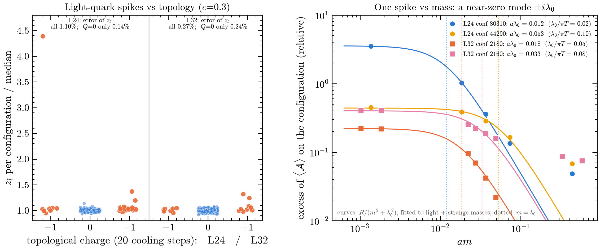{.tall}

::: {.note style="text-align:center"}
Spikes are $|Q|=1$ configurations with one near-zero Dirac mode ($a\lambda_0=0.012$–$0.053$, fitted from the mass dependence of $z$).
In the $Q=0$ sector the light error drops from $1.10\%$ to $0.14\%$ on $24^3\times6$. Tune with strange: one factor for all flavours.
:::

## Backup · tuned ratio vs c {.p1 .wip}

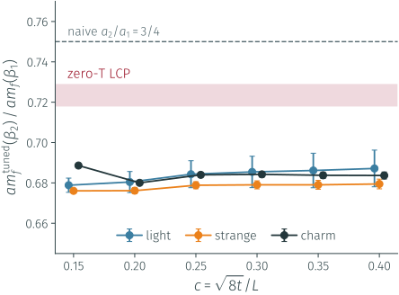{.tall}

::: {.note style="text-align:center"}
The tuned ratio $am(\beta_2)/am(\beta_1)$ is flat in $c\in[0.15,0.40]$ and the same for $l,s,c$;
the zero-$T$ LCP sits 6–7 % higher, the naive $3/4$ higher still.
:::

## Backup · topology is not frozen {.p2}

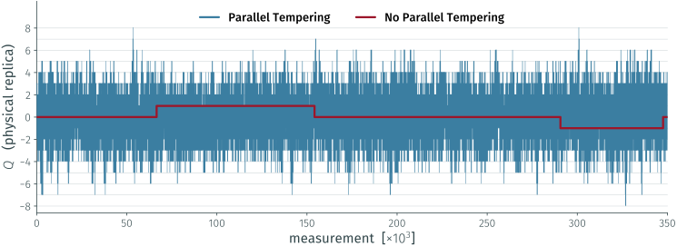

::: {.note style="text-align:center"}
$CP^{20}$, $L=150$, $N_R=12$, optimised schedule, ~350k measurements: the periodic replica visits $Q=-8\dots+8$.
:::
